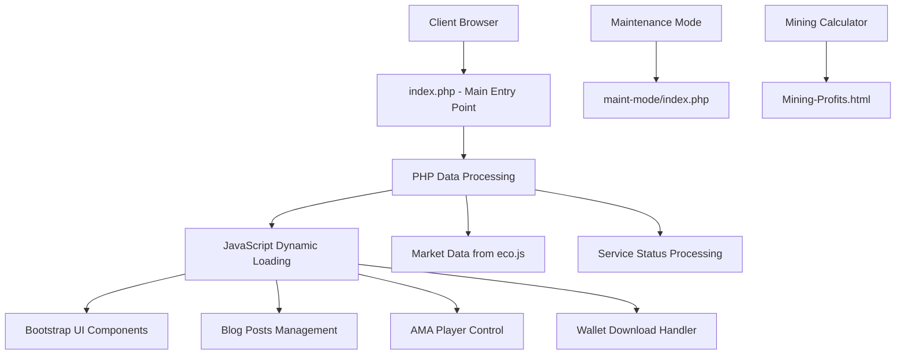
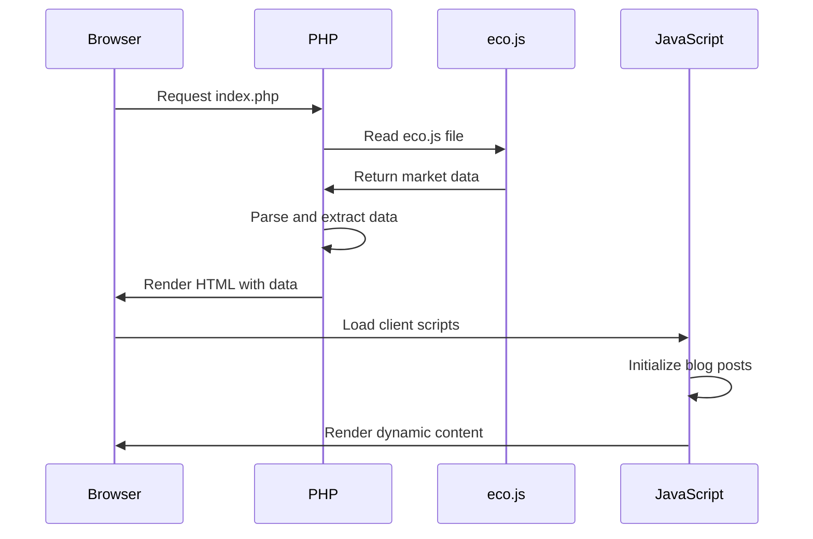

# Dingocoin Website - Comprehensive Technical Documentation

## Project Overview

The Dingocoin website is a modern, responsive cryptocurrency project website built using PHP for server-side processing and vanilla JavaScript for client-side interactions. It serves as the main hub for the Dingocoin cryptocurrency community, providing information, wallet downloads, market data, and various interactive features.

### Key Features
- **Dynamic Market Data Display**: Real-time cryptocurrency market statistics
- **Multi-Platform Wallet Downloads**: Automated wallet selection and download system
- **Blog Post Management**: Dynamic blog content loading with pagination
- **AMA Audio Player**: Interactive audio player for community sessions
- **Maintenance Mode**: Separate maintenance interface
- **Mining Calculator**: Profitability calculation tool
- **Responsive Design**: Bootstrap-based responsive layout

---

## Architecture Overview

The website follows a **hybrid architecture** combining:



### Technology Stack
- **Backend**: PHP 8.1+
- **Frontend**: HTML5, CSS3, JavaScript (ES6+)
- **Framework**: Bootstrap 5.3.0
- **Icons**: Font Awesome 6.4.0
- **Audio**: HTML5 Audio API
- **Styling**: Custom CSS with CSS Variables

---

## File Structure

```
dingocoin-website/
├── index.php                 # Main application entry point
├── Mining-Profits.html        # Mining profitability calculator
├── css/
│   ├── style.css             # Main stylesheet
│   ├── style-blog-post.css   # Blog-specific styles
│   ├── bootstrap.min.css     # Bootstrap framework
│   └── font_awesome_6_4.css  # Icon fonts
├── js/
│   ├── script-main-1.js      # Primary JavaScript functionality
│   └── blog-posts.js         # Blog post management
├── img/                      # Image assets
│   ├── logos/               # Brand logos and icons
│   ├── blog/                # Blog post thumbnails
│   ├── exchanges/           # Exchange logos
│   ├── sitemain/            # Main site images
│   └── trailmap/            # Roadmap images
├── includes/
│   ├── pages/
│   │   ├── top_nav.html     # Navigation component
│   │   └── footer.html      # Footer component
│   └── media/
│       └── ama/             # AMA audio files
├── docs/                     # Documentation and PDFs
├── downloads/                # Downloadable resources
└── maint-mode/              # Maintenance mode interface
    ├── index.php
    ├── css/
    ├── img/
    └── includes/
```

---

## PHP Processing & Server-Side Logic

### Main PHP File: `index.php`

The main PHP file handles server-side data processing and template rendering.

#### Data Extraction System

```php
<?php
//===========================================
// Data Extraction from eco.js
//===========================================

// Read the JS file contents
$js_content = file_get_contents(__DIR__ . '/api/data/eco.js');

// Parse ecoData JSON object from JS file
preg_match('/const ecoData = ({[^;]+});/', $js_content, $matches);
$json_str = str_replace('\"', '"', str_replace("\\/", "/", $matches[1]));
$ecoData = json_decode($json_str, true);
?>
```

**Analysis**: This system reads cryptocurrency data from a JavaScript file and parses it for PHP usage. The data includes:

#### Market Data Variables
```php
// Extract Market Data
$cmcRank = $ecoData['cmcRank'];           // CoinMarketCap ranking
$price = $ecoData['price'];               // Current price
$volume24h = $ecoData['volume24h'];       // 24-hour trading volume
$marketCap = $ecoData['marketCap'];       // Market capitalization
```

#### Network Statistics
```php
// Extract Network Statistics
$hashrate = $ecoData['hashrate'];         // Network hash rate
$difficulty = $ecoData['difficulty'];     // Mining difficulty
$blockHeight = $ecoData['blockHeight'];   // Current block height
$circulatingSupply = $ecoData['circulatingSupply']; // Circulating supply
```

#### Service Status Management
```php
// Extract Service Status Variables
$wrapStatus = $ecoData['wrapStatus'];         // Wrapped token service
$explorerStatus = $ecoData['explorerStatus']; // Blockchain explorer
$nftStatus = $ecoData['nftStatus'];           // NFT platform
$blogStatus = $ecoData['blogStatus'];         // Blog service
$discordStatus = $ecoData['discordStatus'];   // Discord community
$githubStatus = $ecoData['githubStatus'];     // GitHub repositories
```

#### Helper Functions

```php
/**
 * Get the appropriate Bootstrap badge class based on status
 * @param string $status The service status
 * @return string The Bootstrap badge class
 */
function getStatusBadgeClass($status) {
    switch ($status) {
        case 'online':
            return 'bg-success';
        case 'maintenance':
            return 'bg-warning';
        default:
            return 'bg-danger';
    }
}

/**
 * Get status display text
 * @param string $status The service status
 * @return string The display text
 */
function getStatusDisplayText($status) {
    switch ($status) {
        case 'online':
            return 'Online';
        case 'maintenance':
            return 'Maintenance';
        default:
            return 'Offline';
    }
}
```

#### Data Integration in HTML

```php
<!-- Market Statistics Display -->
<li class="list-group-item d-flex justify-content-between bg-dark text-white">
    <span class="fs-6 fs-md-5">Price:</span>
    <strong class="fs-6 fs-md-5">
        <?php echo $price; ?>
    </strong>
</li>
<li class="list-group-item d-flex justify-content-between bg-dark text-white">
    <span class="fs-6 fs-md-5">Market Cap:</span>
    <strong class="fs-6 fs-md-5">
        <?php echo $marketCap; ?>
    </strong>
</li>
```

### Maintenance Mode: `maint-mode/index.php`

```php
<?php include('includes/pages/top_nav.html'); ?>
<div class="container-xxl ply-5">
    <div class="container">
        <div class="row d-flex align-items-center justify-content-center">
            <div class="col-12 col-md-6">
                <div class="card">
                    <div class="card-body">
                        
                        <p class="text-center">Down For Maintenance</p> 
                        <p class="text-center">We are undergoing some system upgrades at this time.</p>
                        <p class="text-center">Please check back later.</p> 
                    </div>
                </div>
            </div>
        </div>
    </div>
</div>
```

**Purpose**: Provides a clean maintenance interface when the main site is unavailable.

---

## JavaScript Functionality & Client-Side Interactions

### Primary Script: `js/script-main-1.js`

This file contains the core JavaScript functionality for blog post management and trilemma content.

#### Blog Post Data Structure

```javascript
const blogPosts = [
    {
        title: "How Dingocoin's Governance Works",
        url: "https://blog.dingocoin.com/how-dingocoins-governance-works/",
        thumbnail: "./img/blog/how-dingo-works.webp",
        excerpt: "Discover how Dingocoin's unique governance model works...",
        seo: { 
            keywords: ["Dingocoin", "governance", "crypto"], 
            description: "Learn about Dingocoin's governance model." 
        },
        bestPractices: "Ensure to engage the community for feedback.",
        performance: "Optimized for fast loading times."
    },
    // ... additional blog posts
];
```

#### Trilemma Posts Structure

```javascript
const trilemmaPosts = [
    {
        title: "Dingo & Blockchain Trilemma",
        url: "https://blog.dingocoin.com/dingocoin-the-blockchain-trilemma/",
        thumbnail: "./img/trilimma/how-dingo-works.webp",
        excerpt: "Dingocoin has solved the Blockchain Trilemma...",
        seo: {
            keywords: ["Dingocoin", "Blockchain Trilemma", "Trilemma"], 
            description: "Dingocoin & The Blockchain Trilemma"
        },
        bestPractices: "Achieving decentralization, security, and scalability"
    },
    // ... additional trilemma posts
];
```

#### Dynamic Card Generation

```javascript
function createBlogCard(post, index) {
    const isMockCard = post.url === '#';
    return `
        <div class="col-md-6 col-lg-3 mb-4" style="animation-delay: ${index * 0.1}s">
            <div class="card custom-card h-100">
                
                <div class="custom-card-body">
                    <div class="custom-card-content">
                        <h5 class="custom-card-title">${post.title}</h5>
                        <p class="custom-card-text">${post.excerpt}</p>
                    </div>
                    <div class="text-center">
                        <a href="${post.url}" class="button custom-card-link ${isMockCard ? 'disabled' : ''}" 
                           ${isMockCard ? 'aria-disabled="true"' : 'target="_blank"'}>
                            ${isMockCard ? 'Coming Soon' : 'Read Article'}
                        </a>
                    </div>
                </div>
            </div>
        </div>
    `;
}
```

**Features**:
- **Error Handling**: Automatic fallback images using `onerror` attribute
- **Accessibility**: Proper ARIA labels and semantic HTML
- **Animation**: Staggered loading animations with CSS delays
- **Responsive Design**: Bootstrap grid system integration

#### Post Loading Management

```javascript
function loadMorePosts() {
    const container = document.getElementById('blogPostsContainer');
    const availablePosts = blogPosts.filter(post => !displayedBlogPosts.has(post.url));

    if (availablePosts.length === 0) {
        document.getElementById('loadMoreBtn').style.display = 'none';
        return;
    }

    // Shuffle the available posts before displaying
    const shuffledPosts = shuffleBlogPosts(availablePosts);
    const postsToAdd = shuffledPosts.slice(0, postsPerLoad);

    postsToAdd.forEach((post, index) => {
        displayedBlogPosts.add(post.url);
        container.innerHTML += createBlogCard(post, index);
    });

    if (displayedBlogPosts.size === blogPosts.length) {
        document.getElementById('loadMoreBtn').style.display = 'none';
    }
}
```

**Algorithm**: 
1. Filters already displayed posts using Set data structure
2. Shuffles remaining posts for variety
3. Loads posts in batches (4 per load)
4. Manages UI state (hide button when no more posts)

#### Randomization Algorithm

```javascript
function shuffleBlogPosts(array) {
    const newArray = [...array];
    for (let i = newArray.length - 1; i > 0; i--) {
        const j = Math.floor(Math.random() * (i + 1));
        [newArray[i], newArray[j]] = [newArray[j], newArray[i]];
    }
    return newArray;
}
```

**Implementation**: Fisher-Yates shuffle algorithm for unbiased randomization.

### Wallet Download System

Embedded directly in `index.php`:

```javascript
function startDownload(event) {
    event.preventDefault(); // Prevent default form submission
    const select = document.getElementById('walletSelect');
    
    if (!select.value) {
        select.classList.add('is-invalid'); // Bootstrap validation
        return;
    } else {
        select.classList.remove('is-invalid');
    }

    const selectedOption = select.options[select.selectedIndex];
    const downloadUrl = selectedOption.getAttribute('data-download-url');
    const openUrl = selectedOption.getAttribute('data-open-url');

    // Open the URL in a new window
    if (openUrl) {
        window.open(openUrl, '_blank');
    }

    // Redirect to the download URL directly
    if (downloadUrl) {
        window.open(downloadUrl, '_blank');
    } else {
        alert('No download URL available for the selected wallet.');
    }
}
```

**Features**:
- **Form Validation**: Bootstrap validation classes
- **Multi-URL Support**: Separate open and download URLs
- **Error Handling**: Graceful handling of missing URLs
- **User Experience**: New window/tab opening for downloads

### AMA Audio Player System

```javascript
document.getElementById('amaSelect').addEventListener('change', function() {
    const audioPlayer = document.getElementById('amaPlayer');
    const audioSource = document.getElementById('audioSource');
    const currentAmaInfo = document.getElementById('currentAmaInfo');
    const amaTitle = document.getElementById('amaTitle');
    const amaDate = document.getElementById('amaDate');
    
    if (this.value) {
        // Update audio source
        audioSource.src = this.value;
        audioPlayer.load();
        
        // Show player and info
        audioPlayer.style.display = 'block';
        currentAmaInfo.style.display = 'block';
        
        // Update info text
        const selectedOption = this.options[this.selectedIndex];
        const [title, date] = selectedOption.text.split(' - ');
        amaTitle.textContent = title;
        amaDate.textContent = date;
    } else {
        // Hide player and info if no selection
        audioPlayer.style.display = 'none';
        currentAmaInfo.style.display = 'none';
    }
});
```

**Functionality**:
- **Dynamic Audio Loading**: Changes audio source based on selection
- **UI State Management**: Shows/hides player and information
- **Text Parsing**: Extracts title and date from option text
- **HTML5 Audio**: Uses native browser audio controls

### Performance Optimization Scripts

#### Lazy Background Loading

```javascript
document.addEventListener("DOMContentLoaded", function() {
    const lazyBackgrounds = document.querySelectorAll('.lazy-bg');

    const options = {
        root: null, 
        rootMargin: '0px',
        threshold: 0.1 
    };

    const observer = new IntersectionObserver((entries, observer) => {
        entries.forEach(entry => {
            if (entry.isIntersecting) {
                const target = entry.target;
                const bgImage = target.getAttribute('data-bg');
                target.style.backgroundImage = `url('${bgImage}')`;
                observer.unobserve(target); 
            }
        });
    }, options);

    lazyBackgrounds.forEach(bg => {
        observer.observe(bg);
    });
});
```

**Implementation**: Intersection Observer API for efficient lazy loading.

#### Smooth Scrolling Navigation

```javascript
function scrollToWallets(event) {
    event.preventDefault(); 
    const target = document.getElementById('wallets');
    if (target) {
        target.scrollIntoView({ behavior: 'smooth' });
    }
}

function scrollToWhitePaper(event) {
    event.preventDefault(); 
    const target = document.getElementById('whitepaper');
    if (target) {
        target.scrollIntoView({ behavior: 'smooth' });
    }
}
```

**Features**: Native smooth scrolling with fallback handling.

---

## Data Flow & Processing

### Data Processing Pipeline



### Market Data Integration

1. **Data Source**: `api/data/eco.js` (referenced but not present in current structure)
2. **Processing**: PHP regex parsing of JavaScript object
3. **Display**: Real-time integration in HTML templates
4. **Updates**: Server-side timestamp tracking

### Blog Post Management Flow

1. **Static Data**: JavaScript arrays with post metadata
2. **Dynamic Loading**: Paginated loading with shuffle algorithm
3. **UI Management**: Show/hide controls based on available content
4. **Performance**: Lazy loading and animation staggering

---

## Frontend Components

### CSS Architecture

#### CSS Variables System


:root {
    --primary: #1e4151;
    --secondary: #999999;
    --light: #FFF;
    --dark: #111111;
}
```

#### Custom Card System

```css
.custom-card {
    background: linear-gradient(135deg, #1e1e1e 0%, #2a2a2a 100%);
    border: 1px solid #444;
    border-radius: 12px;
    transition: transform 0.3s ease, box-shadow 0.3s ease;
}

.custom-card:hover {
    transform: translateY(-5px);
    box-shadow: 0 10px 25px rgba(0,0,0,0.3);
}


#### Responsive Button System


.btn {
    font-weight: 500;
    transition: .5s;
}

.btn.btn-primary {
    color: #FFFFFF;
}

.btn-square {
    width: 38px;
    height: 38px;
}
```

Bootstrap Integration

- **Grid System**: Responsive 12-column layout
- **Components**: Cards, modals, navbars, forms
- **Utilities**: Spacing, typography, colors
- **JavaScript**: Modal, dropdown, collapse functionality

Icon System

- **Font Awesome 6.4.0**: Primary icon library
- **Loading Strategy**: Separate loading for legacy and modern browsers
- **Performance**: Deferred loading with module/nomodule pattern

Performance Optimizations

Image Optimization

1. **WebP Format**: Modern image format for better compression
2. **Responsive Images**: Multiple sizes with `srcset` attribute
3. **Lazy Loading**: Intersection Observer API implementation
4. **Error Handling**: Automatic fallback to placeholder images

JavaScript Optimization

1. **Deferred Loading**: Non-blocking script execution
2. **Module Pattern**: Modern ES6+ features with fallbacks
3. **Event Delegation**: Efficient event handling
4. **Memory Management**: Proper cleanup of observers

CSS Optimization

1. **Critical CSS**: Inline critical styles
2. **Media Queries**: Print-specific stylesheets
3. **CSS Variables**: Consistent theming system
4. **Minification**: Compressed production assets

Network Optimization

1. **CDN Usage**: Bootstrap and Font Awesome from CDN
2. **Resource Hints**: Preload, preconnect directives
3. **Caching**: Proper cache headers (assumed)
4. **Compression**: Gzip/Brotli compression (server-level)

## Security Considerations

Input Validation

// Wallet selection validation
if (!select.value) {
    select.classList.add('is-invalid');
    return;
}

XSS Prevention

1. **HTML Encoding**: Proper escaping in PHP output
2. **Content Security Policy**: Recommended implementation
3. **Input Sanitization**: Form validation and sanitization

Data Security
1. **No Sensitive Data**: Public information only
2. **External Links**: `rel="nofollow noopener noreferrer"`
3. **HTTPS**: Assumed secure connection

Deployment & Maintenance

File Dependencies
Required Files:
├── index.php (main entry point)
├── css/style.css (core styles)
├── js/script-main-1.js (core functionality)
├── api/data/eco.js (data source - currently missing)
└── img/ (image assets)

Optional Files:
├── maint-mode/ (maintenance interface)
├── Mining-Profits.html (calculator tool)
└── includes/media/ama/ (audio files)


Conclusion
The Dingocoin website represents a well-structured, modern web application that effectively combines PHP server-side processing with dynamic JavaScript functionality. The architecture supports scalability, maintainability, and performance while providing a rich user experience for the cryptocurrency community.

Key strengths include:
- **Modular Architecture**: Clear separation of concerns
- **Performance Focus**: Multiple optimization strategies
- **User Experience**: Responsive design and interactive features
- **Maintainability**: Clean code structure and documentation

This documentation serves as a comprehensive guide for developers working on the Dingocoin website, providing both high-level architectural understanding and detailed code-level analysis.

